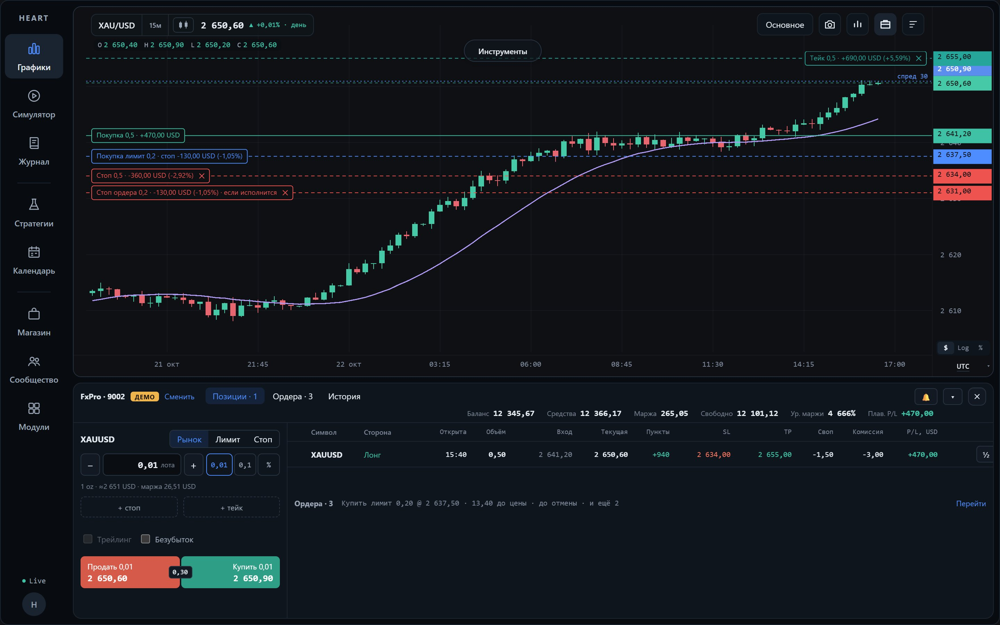

# HEART

**Торговый терминал, который работает в браузере.** Графики с индикаторами и алертами, торговля через cTrader прямо с графика, бэктест стратегий, боты на Python, журнал сделок, симулятор и экономический календарь в одном окне.

**Страница проекта:** https://exswat.github.io/heart-terminal/

| | |
| --- | --- |
| **Проект** | Личный, без команды и заказчика: делаю для себя как трейдер |
| **Моя роль** | Самостоятельная разработка от идеи до готового раздела: архитектура, функциональность, решения о том, что войдёт в проект |
| **Проверка** | Каждое изменение проходит автотесты и мою проверку в браузере |

Исходный код HEART лежит в закрытом репозитории. Здесь только витрина: описание и скриншоты работающего терминала.

## В цифрах

| | |
| --- | --- |
| TypeScript | ≈ 55 тыс. строк |
| Go (сервер) | ≈ 18 тыс. строк |
| Сквозные тесты (Playwright) | 227 |
| Модульные тесты (Vitest) | 410+ |
| Тесты сервера (Go) | 130 |
| Разделов в приложении | 8 |
| Архив котировок | ≈ 7 ГБ |

## Разделы

### Графики

Живые котировки Binance и cTrader. Свечи, полые свечи, бары, линия, область и Хайкин-Аши; сетка до четырёх графиков синхронизирует инструмент, таймфрейм и время. Индикаторы считаются в отдельном потоке и двигаются вместе с формирующейся свечой, график рисует собственный движок на WebGPU, а где его нет, Canvas. На скриншоте выше: торговые сессии (Сидней, Токио, Лондон, Нью-Йорк), SMA 20 и объём.

- 31 инструмент рисования, горячие клавиши и шпаргалка по «?»
- алерты на цену, линию, RSI, скользящую и MACD
- снимок графика в буфер, в PNG или к сделке журнала
- пивоты, уровни прошлого дня и недели, OBV, A/D, MFI, CMF

### Торговля через cTrader

Любой инструмент счёта cTrader торгуется со своего графика: с тикета, клавишами Shift+B и Shift+S, лимитом или стопом из меню графика и кнопкой «+» у цены, ордером из нарисованной длинной или короткой позиции. Стопы, тейки и ордера стоят на графике с деньгами, которые они принесут или заберут, и перетаскиваются мышью. Трейлинг ведёт брокер, безубыток переносит сервер HEART. На реальном счёте каждое действие подтверждается, заявка не уходит дважды, по устаревшим данным счёта торговли нет.

> Счёт, позиция и котировки на этом скриншоте — пример: снято на тестовом брокере.

### Стратегии и бэктест

Стратегию можно прогнать по истории за несколько секунд: доходность, просадка, профит-фактор, издержки и сравнение с «купить и держать». Последние 30% истории откладываются: стратегия проверяется на данных, по которым параметры не подбирались. Прогоны можно сравнивать между собой.

На скриншоте стратегия убыточна, и терминал так и пишет: на подборе прибыли нет, проверять нечего.

### Конструктор ботов

Правила входа и выхода собираются из индикаторов и условий, без кода. Конструктор пересказывает бота обычными словами и предупреждает о слабых местах, например когда не задан тейк-профит.

### Редактор кода

Индикатор пишется на TypeScript и сразу появляется на графике. Бот пишется на Python и запускается прямо в браузере через Pyodide, устанавливать ничего не нужно.

| Бот на Python | Индикатор на TypeScript |
| --- | --- |
|  |  |

### Журнал сделок

Сделки попадают в журнал вручную, из cTrader или с фьючерсного счёта Binance (только чтение). Результат каждой сделки считается в R: прибыль, делённая на риск до стопа. Календарь месяца подсвечивает прибыльные и убыточные дни, по сетапам считается винрейт, а в разборе сделки видны снимок графика и новости, которые выходили в это время.

> Данные на этом скриншоте — пример. Счёт «Пример» и сделки созданы для витрины.

### Симулятор

Рынок открывается по одной свече, будущее скрыто. Сделки идут на виртуальный счёт с комиссией и проскальзыванием.

### Экономический календарь

События недели с фильтром по валютам и важности. Для ближайшего события идёт обратный отсчёт и показаны сценарии для валюты и золота. Данные приходят через собственный сервер на Go (источник FXStreet).

### Модули

Каждый раздел можно выключить: он пропадает из меню, и его код не загружается. Границы между разделами проверяет скрипт перед каждым коммитом.

## Как я работаю

1. **Задача.** Формулирую, что должно получиться и как это проверить. Например: «запуск не медленнее, чем до изменений».
2. **Код и тесты.** Каждое изменение идёт с тестами: сквозные в браузере, модульные и серверные.
3. **Проверка.** Перед каждым коммитом сами запускаются проверка типов, тесты и контроль границ между модулями. Потом смотрю результат в браузере.
4. **Решение.** Оставляю, переделываю или убираю совсем, если идея не подтвердилась.

### Где результат не приняли на веру

- **Модели сессий — удалено.** Торговые модели собраны по методичке и прогнаны через бэктест. Преимущества на истории они не показали, поэтому вкладка и движок удалены целиком.
- **Источник календаря — заменено.** Investing начал ограничивать запросы. Календарь переведён на FXStreet через собственный сервер, запросы не отправляются пачками.
- **Скорость после перестройки — измерено.** После разбивки на модули запуск занимает 366 мс (было 388), первое открытие раздела 5–11 мс (было 310).
- **Ключи и секреты — защищено.** Ключи Binance хранятся зашифрованными средствами Windows (DPAPI), секреты не попадают в адреса запросов и тексты ошибок, доступ к счёту Binance только на чтение.
- **Реальный счёт — защищено.** Каждое действие просит второго нажатия, двойной щелчок за подтверждение не считается. Заявка не уходит дважды, по данным счёта старше 10 секунд торговли нет, «Безубыток» не возвращает на вход стоп, который уже в прибыли.
- **Фокус на терминале — убрано.** Структура рынка, линии 4h и дня, импульсы и панель деривативов убраны, чтобы довести до ума сам терминал.

## Стек

| | |
| --- | --- |
| Интерфейс | TypeScript, React 19, Vite, Zustand |
| Графики | Собственный движок отрисовки на WebGPU с запасным Canvas |
| Сервер | Go: история котировок, торговля через cTrader и безубыток, календарь |
| Боты | Python в браузере через Pyodide, бэктест на TypeScript |
| Тесты | Playwright, Vitest, go test |
| Данные | Binance, cTrader, FXStreet |
| Разработка | Git |

**Дальше:** магазин индикаторов и ботов, лента идей сообщества и публикация своих модулей.

---

Скриншоты сняты с работающего терминала 21 и 25 октября 2026 года. Котировки и события настоящие, сделки в журнале и счёт на скриншоте торговли — пример.
