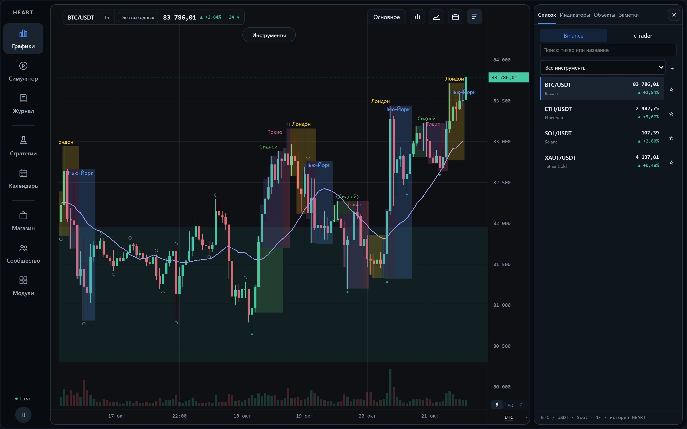
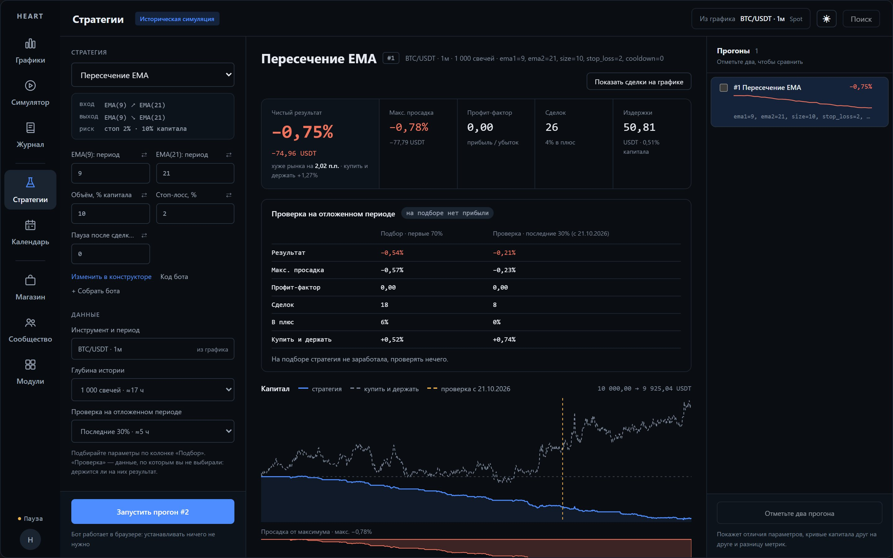
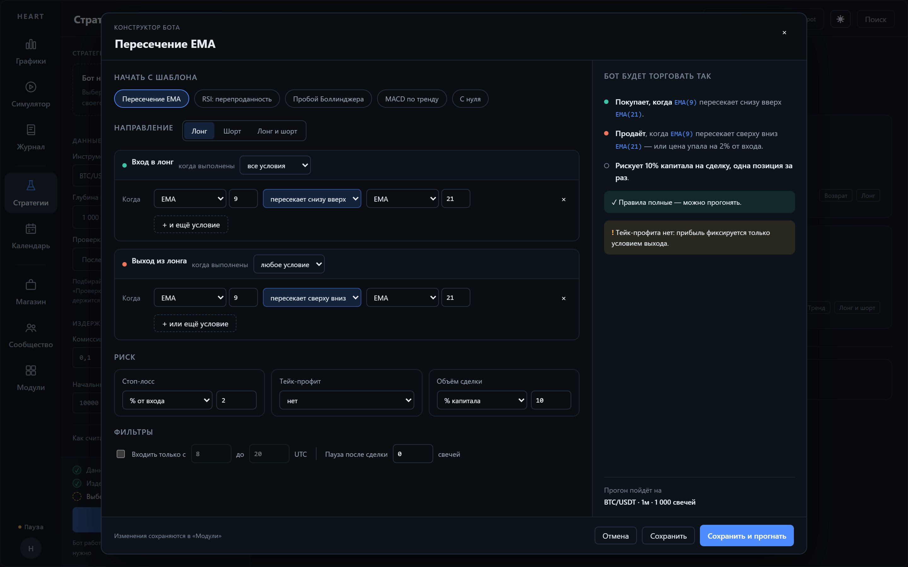
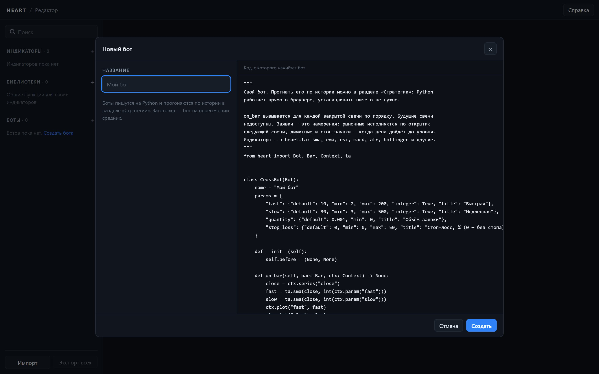
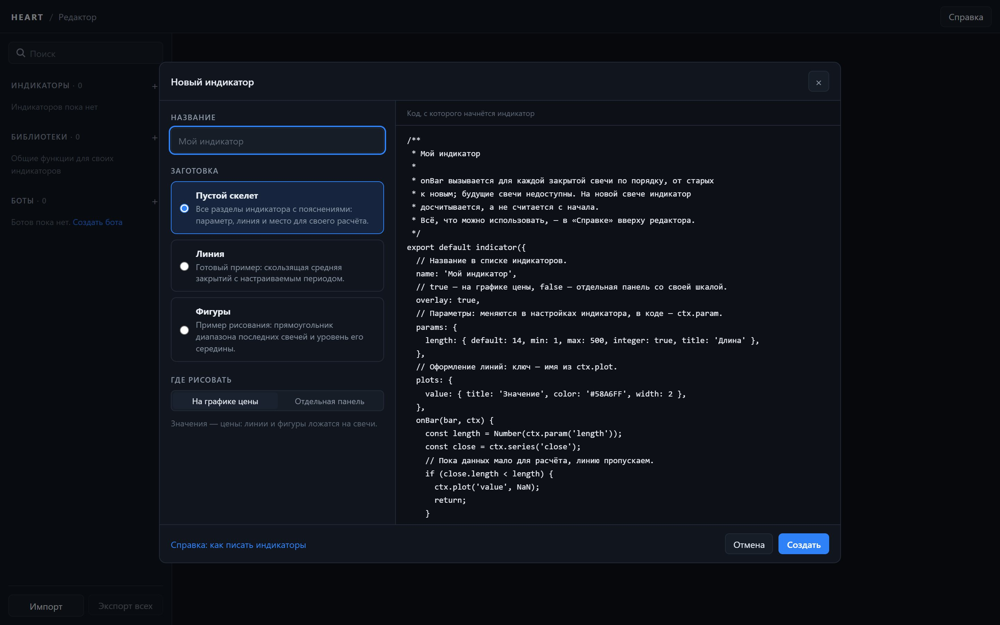
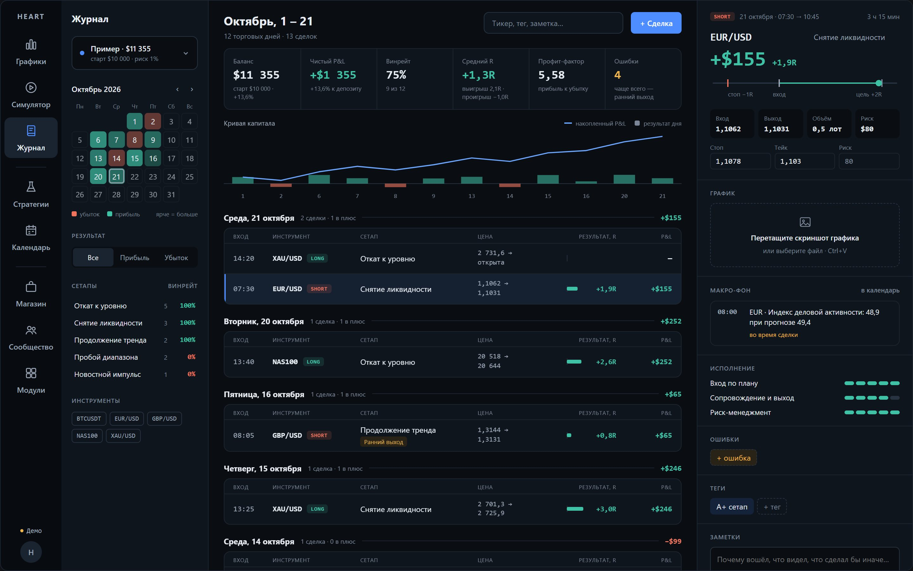
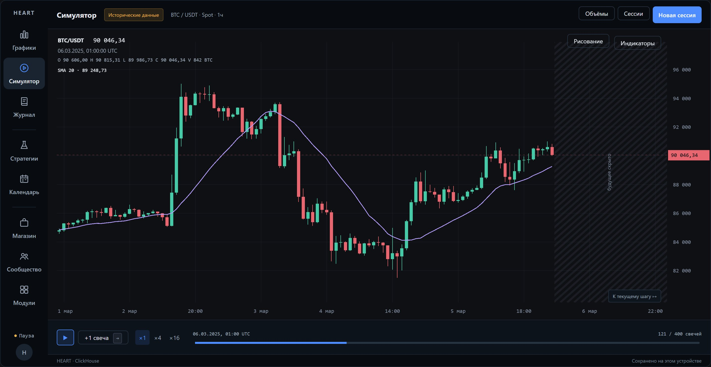
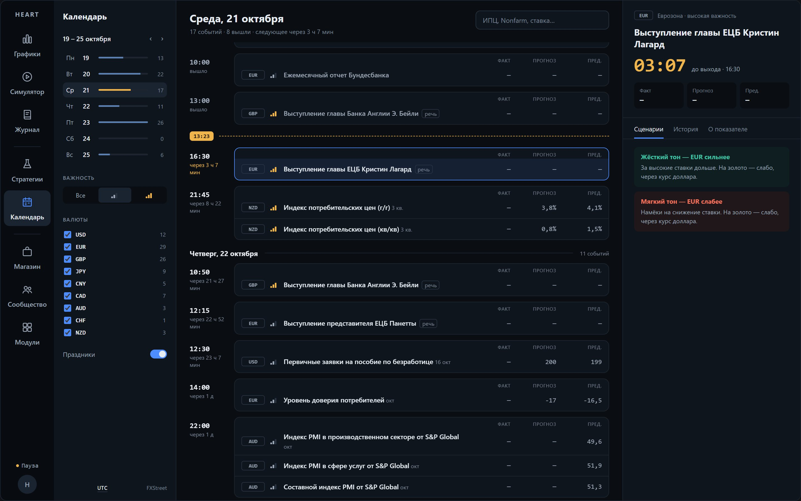
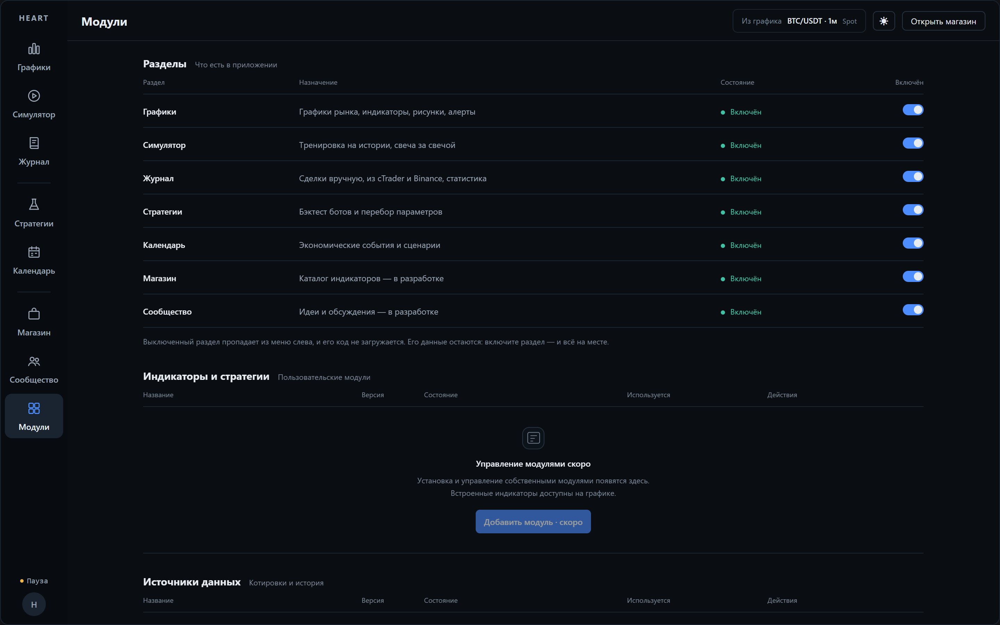

# HEART

**Торговый терминал, который работает в браузере.** Графики с индикаторами, бэктест стратегий, боты на Python, журнал сделок, симулятор и экономический календарь в одном окне.

**Страница проекта:** https://exswat.github.io/heart-terminal/

| | |
| --- | --- |
| **Проект** | Личный, без команды и заказчика: делаю для себя как трейдер |
| **Моя роль** | Самостоятельная разработка от идеи до готового раздела: архитектура, функциональность, решения о том, что войдёт в проект |
| **Проверка** | Каждое изменение проходит автотесты и мою проверку в браузере |

Исходный код HEART лежит в закрытом репозитории. Здесь только витрина: описание и скриншоты работающего терминала.

## В цифрах

| | |
| --- | --- |
| TypeScript | ≈ 49 тыс. строк |
| Go (сервер) | ≈ 16 тыс. строк |
| Сквозные тесты (Playwright) | 157 |
| Модульные тесты (Vitest) | 360+ |
| Тесты сервера (Go) | 110+ |
| Разделов в приложении | 8 |
| Архив котировок | ≈ 7 ГБ |

## Разделы

### Графики

Живые котировки Binance и cTrader. Индикаторы считаются в отдельном потоке, график рисует собственный движок на WebGPU. На скриншоте выше: торговые сессии (Сидней, Токио, Лондон, Нью-Йорк), структура рынка и объём.

### Стратегии и бэктест

Стратегию можно прогнать по истории за несколько секунд: доходность, просадка, профит-фактор, издержки и сравнение с «купить и держать». Последние 30% истории откладываются: стратегия проверяется на данных, по которым параметры не подбирались. Прогоны можно сравнивать между собой.

На скриншоте стратегия убыточна, и терминал так и пишет: на подборе прибыли нет, проверять нечего.

### Конструктор ботов

Правила входа и выхода собираются из индикаторов и условий, без кода. Конструктор пересказывает бота обычными словами и предупреждает о слабых местах, например когда не задан тейк-профит.

### Редактор кода

Индикатор пишется на TypeScript и сразу появляется на графике. Бот пишется на Python и запускается прямо в браузере через Pyodide, устанавливать ничего не нужно.

| Бот на Python | Индикатор на TypeScript |
| --- | --- |
|  |  |

### Журнал сделок

Сделки попадают в журнал вручную, из cTrader или с фьючерсного счёта Binance (только чтение). Результат каждой сделки считается в R, то есть в долях риска. Календарь месяца подсвечивает прибыльные и убыточные дни, по сетапам считается винрейт, а в разборе сделки видны новости, которые выходили в это время.

> Данные на этом скриншоте — пример. Счёт «Пример» и сделки созданы для витрины.

### Симулятор

Рынок открывается по одной свече, будущее скрыто. Сделки идут на виртуальный счёт с комиссией и проскальзыванием.

### Экономический календарь

События недели с фильтром по валютам и важности. Для ближайшего события идёт обратный отсчёт и показаны сценарии для валюты и золота. Данные приходят через собственный сервер на Go (источник FXStreet).

### Модули

Каждый раздел можно выключить: он пропадает из меню, и его код не загружается. Границы между разделами проверяет скрипт перед каждым коммитом.

## Как я работаю

1. **Задача.** Формулирую, что должно получиться и как это проверить. Например: «запуск не медленнее, чем до изменений».
2. **Код и тесты.** Каждое изменение идёт с тестами: сквозные в браузере, модульные и серверные.
3. **Проверка.** Перед каждым коммитом сами запускаются проверка типов, тесты и контроль границ между модулями. Потом смотрю результат в браузере.
4. **Решение.** Оставляю, переделываю или убираю совсем, если идея не подтвердилась.

### Где результат не приняли на веру

- **Модели сессий — удалено.** Торговые модели собраны по методичке и прогнаны через бэктест. Преимущества на истории они не показали, поэтому вкладка и движок удалены целиком.
- **Источник календаря — заменено.** Investing начал ограничивать запросы. Календарь переведён на FXStreet через собственный сервер, запросы не отправляются пачками.
- **Скорость после перестройки — измерено.** После разбивки на модули запуск занимает 366 мс (было 388), первое открытие раздела 5–11 мс (было 310).
- **Ключи и секреты — защищено.** Ключи Binance хранятся зашифрованными средствами Windows (DPAPI), секреты не попадают в адреса запросов и тексты ошибок, доступ к счёту Binance только на чтение.

## Стек

| | |
| --- | --- |
| Интерфейс | TypeScript, React 19, Vite, Zustand |
| Графики | Собственный движок отрисовки на WebGPU |
| Сервер | Go: история котировок, связь с cTrader и календарём |
| Боты | Python в браузере через Pyodide, бэктест на TypeScript |
| Тесты | Playwright, Vitest, go test |
| Данные | Binance, cTrader, FXStreet |
| Разработка | Git |

**Дальше:** магазин индикаторов и ботов, лента идей сообщества и публикация своих модулей.

---

Скриншоты сняты с работающего терминала 21 октября 2026 года. Котировки и события настоящие, сделки в журнале — пример.
